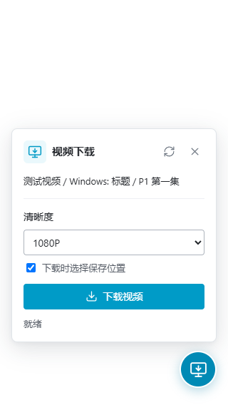

# Bilibili Video Saver

下载当前 B 站视频分 P，使用当前登录账号可播放的画质。提供 Edge 扩展和 Tampermonkey 油猴脚本两种形式，均直接使用 B 站 API 和视频 CDN，不经过第三方解析站。



## 选择安装方式

| 形式 | 当前版本 | 使用方式 | 适合情况 |
| --- | --- | --- | --- |
| Edge 扩展 | 1.4.0 | 从浏览器工具栏打开扩展弹窗 | 想使用独立扩展，不需要页面悬浮按钮 |
| Tampermonkey 脚本 | 1.1.0 | B 站页面右侧悬浮图标，点开下载菜单 | 已使用油猴，希望在页面内快速操作 |

最新安装文件和版本说明见 [GitHub Releases](https://github.com/yangyyyy15/bilibili-video-saver-edge/releases/latest)。

## Edge 扩展

1. 从最新 Release 下载 `bilibili-video-saver-edge-v1.4.0.zip` 并解压。
2. 打开 `edge://extensions`，启用“开发人员模式”。
3. 点击“加载解压缩的扩展”，选择解压后包含 `manifest.json` 的目录。
4. 打开 `bilibili.com/video/...` 视频页，点击工具栏中的 Bilibili Video Saver 图标，选择清晰度并下载。

请保留解压目录在固定位置。开发人员模式加载的扩展不会随 Edge 账户同步；Edge 重新启动或浏览器配置文件切换后，请确认扩展仍已启用。正式商店安装需要先由作者发布并通过 Edge Add-ons 审核。

## Tampermonkey 油猴脚本

1. 在 Edge 扩展商店安装 Tampermonkey（篡改猴）。
2. 下载 Release 附件 `bilibili-video-saver.user.js`，在 Tampermonkey 管理面板的“实用工具”中选择“从文件导入”并确认安装。
3. 打开或刷新 B 站视频页。页面右侧蓝色圆形图标可以上下拖动并记住位置，点击后展开下载菜单。

首次使用时，按提示允许脚本访问 B 站 API、视频 CDN 和浏览器下载。若油猴报告下载未启用，请在油猴设置中启用下载并选择“浏览器 API”模式；若提示扩展名不在白名单中，请允许 `mp4`、`flv` 和 `m4v`。已安装旧版本的用户重新导入新脚本时，请确认更新现有脚本，然后刷新 B 站页面。

## 功能与限制

- 使用浏览器当前的 B 站登录会话，不读取或导出 Cookie，不绕过账号权限或会员限制。
- 根据当前视频地址和分 P 获取可用清晰度；画质受 B 站 API、账号权限和视频内容限制。脚本和扩展在 API 返回其他清晰度时会显示实际画质。
- 下载前重新获取有时效的签名地址。地址过期时刷新视频页或重新点击下载。
- 当前只支持播放接口返回的单文件 MP4、FLV 或 M4V；多片段和需要合并的 DASH 音视频不支持。
- 番剧专用页、直播和批量下载不在支持范围内。
- 油猴脚本支持页面内悬浮菜单、拖动记忆位置、下载进度和取消。Edge 扩展使用浏览器工具栏弹窗。

## 开发与验证

油猴版源码位于 [`userscript/bilibili-video-saver.user.js`](userscript/bilibili-video-saver.user.js)，安装与诊断说明见 [`userscript/README.md`](userscript/README.md)。使用 Node.js 和 Edge 可运行：

```powershell
npm install --prefix "$env:TEMP\bili-userscript-qa" playwright
node .\userscript\verify.cjs
node .\userscript\diagnose-download.cjs
```

浏览器模拟验证涵盖画质降级、签名地址、分 P 切换、下载进度及取消、错误路径、拖动和窗口边界。模拟环境不等于使用真实 B 站账号下载完整视频。

## License

MIT. See [LICENSE](LICENSE). The embedded Lucide icons in the userscript include their respective MIT and ISC notices.
